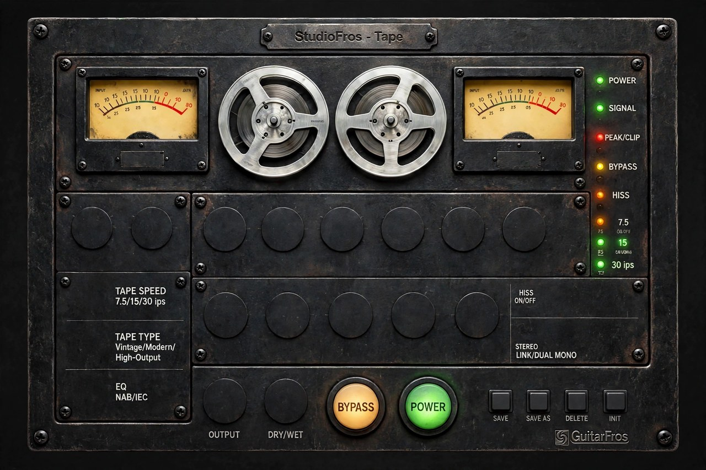

# StudioFros – Tape Machine

A tape machine effect by **GuitarFros** with a vintage reel-to-reel panel. It adds the character of classic studio
reel-to-reel machines: warm saturation, head bump, high-frequency loss, tape compression, wow &
flutter, dropouts and hiss. Available as **VST3** and **Standalone** (Linux, Windows, macOS).



*Panel artwork (before the controls are drawn on top of it).*

## Controls

| Section | Control | What it does |
|---|---|---|
| **Input** | Input | Input trim, ±12 dB |
| | Drive | How hard the signal hits the tape (0–18 dB) |
| | Speed (switch) | 7.5 / 15 / 30 ips – changes head bump, HF loss, wow/flutter depth and hiss |
| | Tape (switch) | Vintage / Modern / High-Output – saturation, bump and hiss character |
| | EQ (switch) | NAB / IEC pre/de-emphasis curves |
| **Character** | Bias | Centre = symmetric; away from centre adds even harmonics |
| | Sat | Amount of tape saturation |
| | Bump | Low-frequency head bump |
| | Tone | Tilt EQ (dark ⇄ bright) |
| | Loss | High-frequency tape loss |
| | Comp | Soft tape compression |
| **Instability** | Wow | Slow speed variation |
| | Flutter | Fast speed variation |
| | Drift | Random slow pitch drift |
| | Degrade | Worn tape: dropouts + extra HF loss |
| | Hiss + Hiss On | Tape noise level, and its on/off button |
| | Link | Stereo link: same speed variation/compression on both channels (off = independent) |
| **Output** | Output | Output trim, ±12 dB |
| | Dry/Wet | Parallel mix |
| | Bypass | Clean bypass (latency-compensated) |
| | Power | Power off: passthrough, LEDs/reels/VUs off |
| **Meters** | VU IN / VU OUT | Analogue-style VU meters (0 VU = –18 dBFS) |
| | LEDs | Power, Signal, Peak/Clip, Bypass, Hiss and the active tape speed |
| | Reels | Spin while powered, faster at higher tape speeds |
| **Presets** | Preset window + ◄ ► | Arrows (or the mouse wheel) = previous/next preset; click the window or the title plate for the full menu |
| | Save | Overwrites the current user preset (asks for a name if it is a factory preset) |
| | Save As | Saves the current settings under a new name |
| | Delete | Deletes the current user preset |
| | Init | Back to the default settings |

User presets are stored in `~/.config/GuitarFros/StudioFros - Tape Machine/Presets` (Linux),
`~/Library/GuitarFros/StudioFros - Tape Machine/Presets` (macOS) and
`%APPDATA%\GuitarFros\StudioFros - Tape Machine\Presets` (Windows).

Hover or drag a knob to see its value. Double-click a knob to reset it.

**Latency:** the plugin reports a fixed latency to the host (about 7 ms at 44.1 kHz) so the dry/wet
mix and bypass stay phase-aligned. DAWs with automatic delay compensation (REAPER, etc.) handle it
for you. For live monitoring through the Standalone, expect a small delay.

## Build from source

### Ubuntu / Debian

```bash
bash build.sh --deps     # first time: installs the system packages, then builds
bash build.sh            # afterwards: just build
```

Or by hand: install the packages listed in `build.sh`, then
`cmake -B build -DCMAKE_BUILD_TYPE=Release && cmake --build build --parallel`.

JUCE 8.0.4 is downloaded automatically the first time. If you already have JUCE, either put it in
`./JUCE` (or add it as a git submodule there) or run CMake with
`-DFETCHCONTENT_SOURCE_DIR_JUCE=/path/to/JUCE`.

**Automatic install.** After a successful build the VST3 is copied to your user VST3 folder, and the
Standalone is copied to `~/.local/bin/StudioFros-TapeMachine`:

| Platform | VST3 destination |
|---|---|
| Linux | `~/.vst3/StudioFros - Tape Machine.vst3` |
| macOS | `~/Library/Audio/Plug-Ins/VST3/` |
| Windows | not automatic by default (the system VST3 folder needs admin rights); enable with `-DTAPE_INSTALL_AFTER_BUILD=ON` from an elevated shell |

Turn the automatic install off with `-DTAPE_INSTALL_AFTER_BUILD=OFF`.

In **REAPER**: `Options → Preferences → Plug-ins → VST`, make sure `~/.vst3` is in the VST paths, click
*Re-scan*, then add *StudioFros - Tape Machine* from the FX browser.

### Windows / macOS

```
cmake -B build -DCMAKE_BUILD_TYPE=Release
cmake --build build --config Release --parallel
```

The Linux, Windows and macOS builds are also produced by GitHub Actions on every push
(`.github/workflows/build.yml`); download them from the *Actions* tab → *Artifacts*. Pushing a tag such as `v1.0.0`
also publishes them as a GitHub Release.

### DSP test (no GUI needed)

```bash
cmake -B build-test -DTAPE_BUILD_TESTS=ON
cmake --build build-test
./build-test/TapeEngineTest_artefacts/Release/TapeEngineTest
```

## The artwork

The whole panel is a picture (`assets/background.png`); the plug-in draws the controls on top of it:
knobs, selector levers, VU needles, LEDs, the lit BYPASS/POWER buttons and the spinning reels. The
embedded files are generated from the original picture, with the dynamic parts removed (lit LEDs,
the title text, the lit buttons):

```bash
pip install opencv-python numpy pillow
python3 tools/prepare_assets.py assets/source/panel-original.webp assets
```

The positions of every control on the 1920 × 1280 picture are in **`Source/Layout.h`**. To use a
different picture, replace `assets/source/panel-original.webp`, re-measure `Source/Layout.h` and the
coordinates at the top of `tools/prepare_assets.py`, and run the script again. The window keeps the
3:2 shape of the picture and can be resized.

## Project layout

```
Source/TapeEngine.h       DSP (header-only, no GUI dependencies)
Source/Parameters.h       Automatable parameters
Source/Presets.h          Factory and user presets
Source/PluginProcessor.*  JUCE processor
Source/PluginEditor.*     Editor
Source/UIComponents.h     Knobs, levers, buttons, LEDs, VU needles, reels
Source/Layout.h           Position of every control on the artwork
assets/                   Artwork embedded in the plug-in (+ source/ original)
tools/prepare_assets.py   Builds assets/*.png from the original picture
tests/EngineTest.cpp      Headless DSP tests
```

## Credits and licence

* © GuitarFros. Released under the **GNU General Public License v3.0** (see `LICENSE`), the same
  licence family JUCE is used under here.
* Built with [JUCE](https://juce.com) 8.
* Panel artwork: generated with **Meta AI** (Meta Platforms, Inc.) and modified for use in this plug-in
  (controls, lights and title added in code). It is distributed here as part of a non-commercial,
  open-source project and is **not** covered by the GPL; see the notice at the end of `LICENSE`.
* The DSP is an original implementation. The tape-physics ideas it draws on (hysteresis-style
  saturation, head bump, wow/flutter, emphasis curves) are general knowledge; the free
  [CHOW Tape Model](https://github.com/jatinchowdhury18/AnalogTapeModel) by Jatin Chowdhury was a
  reference for what a tape plug-in should expose. No code was copied from it.
* VST is a registered trademark of Steinberg Media Technologies GmbH.
